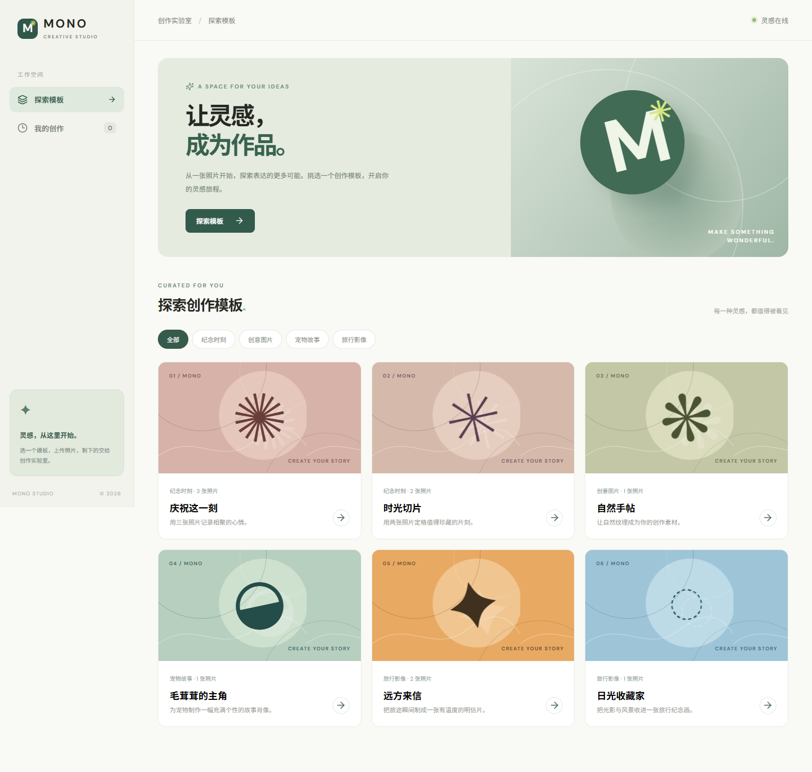
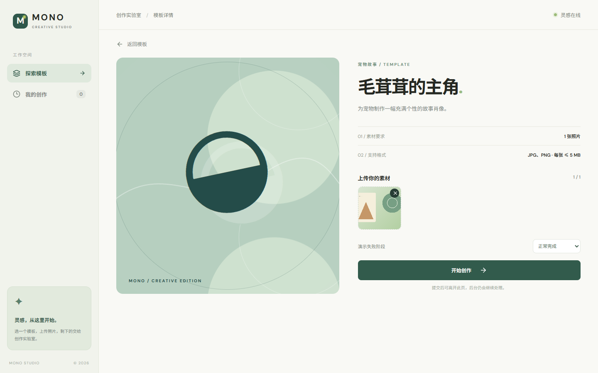
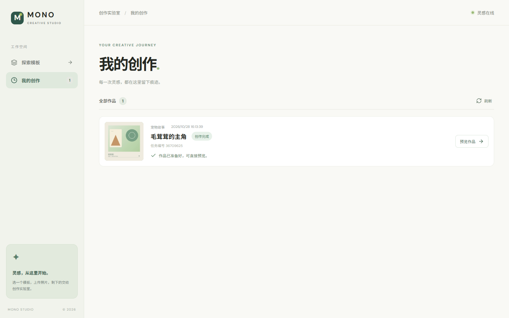
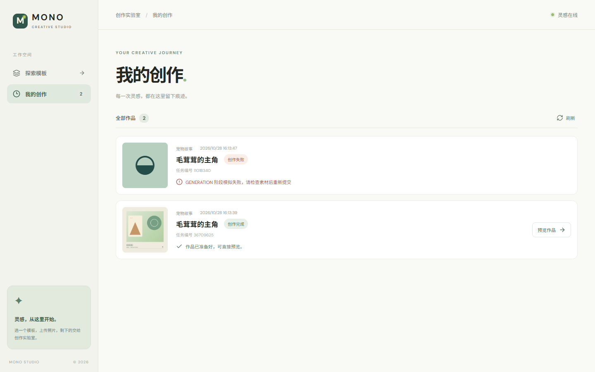

# MONO 创作实验室

一个可独立运行的素材制作网站：浏览模板、上传图片、提交后台任务、查看三阶段处理状态，以及恢复个人历史和预览结果。模拟生成会把第一张上传图片排版成作品图，用于演示完整业务闭环；不调用真实 AI 服务。

## 实际运行界面

以下图片从本仓库运行中的前后端截取，使用独立匿名身份和项目内原创的 [演示图片](docs/demo/sample.png)。点击图片可在 GitHub 查看原图。

| 模板列表与分类 | 模板详情与上传预览 |
| --- | --- |
|  |  |

| 成功任务与结果 | 指定阶段失败与历史 |
| --- | --- |
|  |  |

截图展示界面外观；异步状态、刷新恢复、身份隔离等行为请按下文步骤在运行环境中验证。

## 技术与目录

- `web/`：Next.js 16.4.3、React 19.1、TypeScript，App Router。浏览器调用同源 `/api/backend/*`，Next Route Handler 转发到 Java。
- `server/`：Java 21、Spring Boot 3.4.5、MyBatis 3.0.4、Flyway、MySQL 8.4。
- `compose.yaml`：MySQL、Java、Next.js 及持久卷。
- `DESIGN.md`：接口、状态流转与 R-01 至 R-14 的映射。

浏览器请求同源 `/api/backend/*`，由 Next.js Route Handler 转发 Cookie 和请求体到 Java `/api/*`；业务执行与持久化均由 Java/MySQL 负责，Next.js 不直接写任务数据。项目还包含 `docs/demo/sample.png` 原创演示素材、`docs/screenshots/` 运行截图、`server/src/main/resources/db/migration/V1__init.sql` 数据库结构及 6 条模板种子数据、`.github/workflows/ci.yml` 和前后端 Dockerfile。

## 启动

推荐安装 Docker Compose 后在仓库根目录运行：

```bash
docker compose up --build
```

打开 `http://localhost:3000`。MySQL 初始化由 Flyway 自动执行，预置 6 个模板。第一次构建需要下载 Maven 和 npm 依赖。

推荐使用 Java 21、Node.js 22 与 MySQL 8.4；Compose 已固定 Java/Node 基础镜像与 MySQL 版本。可用 `docker compose ps` 查看容器状态，`docker compose logs --tail=100 server` 或 `docker compose logs --tail=100 web` 排查启动问题。`docker compose down` 停止并移除容器，默认保留 `mysql_data` 和 `media_data` 持久卷；再次执行 `docker compose up --build -d` 即可启动。默认数据库密码只适合本地演示，其他环境请更换。

Java Docker 构建使用 `server/docker-settings.xml` 中的阿里云公开 Maven 镜像，以适配 Docker 容器无法直连 Maven Central 的网络环境；本地 Maven 与 GitHub Actions 仍使用各自默认配置。

本地分开运行：先启动 MySQL，并创建 `atelier` 数据库和 `atelier` 用户（密码 `atelier`）；在 `server` 执行 `mvn spring-boot:run`，在 `web` 执行 `npm ci && npm run dev`。环境变量可覆盖 `DB_URL`、`DB_USER`、`DB_PASSWORD`、`STORAGE_DIR`、`STAGE_DELAY_MS`、`DEMO_FAILURE_ENABLED` 和 `API_INTERNAL_URL`。后端默认端口 8080，前端默认 3000。

在空 MySQL 实例上的本地初始化示例（使用已有管理账号执行，按需要修改演示密码）：

```sql
CREATE DATABASE atelier CHARACTER SET utf8mb4 COLLATE utf8mb4_unicode_ci;
CREATE USER 'atelier'@'localhost' IDENTIFIED BY 'atelier';
GRANT ALL PRIVILEGES ON atelier.* TO 'atelier'@'localhost';
```

首次启动 Java 时，Flyway 自动建表并插入模板，无需手动导入 SQL。建议使用空库，避免与已有同名表冲突。Windows PowerShell 可以用 `$env:DB_USER = '...'` 设置当前终端的连接变量。

| 环境变量 | 本地默认值 / Compose 值 | 作用 |
|---|---|---|
| `DB_URL` | `jdbc:mysql://localhost:3306/atelier?...` / `jdbc:mysql://db:3306/atelier?...` | Java 连接数据库；容器中使用服务名 `db` |
| `DB_USER`、`DB_PASSWORD` | `atelier`、`atelier` | 本地演示凭据，实际部署请替换 |
| `PORT` | `8080` | Java 监听端口 |
| `STORAGE_DIR` | `./storage` / `/app/storage` | Java 可读写的素材与结果目录 |
| `STAGE_DELAY_MS` | `1800` | 每阶段模拟等待毫秒数，调大便于观察处理中 |
| `DEMO_FAILURE_ENABLED` | `true` | 是否接受指定阶段失败参数 |
| `API_INTERNAL_URL` | `http://localhost:8080` / `http://server:8080` | Next.js 服务端到 Java 的地址 |

完整值见 [后端配置](server/src/main/resources/application.yml) 和 [Compose 配置](compose.yaml)。模板封面来自 `web/public/covers/` 的本地 SVG，不依赖外部图片服务。不要提交真实数据库密码。

## 测试与 CI

```bash
cd server && mvn test package
cd ../web && npm ci && npm run lint && npm run typecheck && npm run test && npm run build
```

`.github/workflows/ci.yml` 在 push 和 pull request 时执行上述检查。验收时以提交链接中的 commit SHA 为准。

另有 `DatabaseFlowIT`，在有独立 MySQL 测试库时设置 `RUN_DB_IT=true`、数据库及素材目录环境变量，再执行 `mvn -Dtest=DatabaseFlowIT test`。该测试实际验证 Flyway、模板读取、成功和失败任务、结果文件、历史及身份隔离；默认 CI 不运行它，因为 CI 不提供 MySQL 服务。

例如在 PowerShell 中先创建空的 `atelier_test` 库并赋予测试账号权限，再执行以下命令（将账号、密码和路径替换成自己的测试环境）：

```powershell
$env:RUN_DB_IT = 'true'
$env:DB_URL = 'jdbc:mysql://localhost:3306/atelier_test?useUnicode=true&characterEncoding=utf8&serverTimezone=Asia/Shanghai'
$env:DB_USER = 'your_test_user'
$env:DB_PASSWORD = 'your_test_password'
$env:STORAGE_DIR = 'D:\temp\atelier-test-media'
cd server
mvn -Dtest=DatabaseFlowIT test
```

这项测试会向测试库和素材目录写入数据，不能指向正式演示库。CI 检查覆盖前端 lint、类型检查、测试、构建及 Java 测试/构建；后端测试重点验证阶段顺序与失败中断，前端测试覆盖多任务、查询异常和选图后可提交。GitHub Actions 的结果应按仓库提交 SHA 查看。

## 主要接口

| 方法 | 路径 | 功能 |
|---|---|---|
| GET | `/api/templates?category=` | 模板及分类筛选 |
| GET | `/api/templates/{id}` | 模板详情 |
| POST | `/api/tasks` | multipart：`templateId`、重复的 `images`、可选 `failAtStage`；返回 202 与任务对象 |
| GET | `/api/tasks` | 当前身份历史 |
| GET | `/api/tasks/{id}` | 当前身份的任务状态，只读 |
| GET | `/api/tasks/{id}/files` | 当前身份的输入文件 ID 与预览 URL |
| GET | `/api/files/{id}` | 受身份限制的输入图片或结果图片预览 |

上表是 Java 端路径；浏览器访问时需加 `/api/backend` 前缀，例如 `/api/backend/tasks`。模板主要字段为 `id`、`title`、`category`、`description`、`coverUrl`、`requiredImageCount`、`acceptedMimeTypes`、`maxFileSizeBytes`。任务主要字段为 `id`、`templateId`、`status`、`currentStage`、`failureReason`、`resultFileId`、`createdAt`、`updatedAt`，另含身份关联的 `ownerId` 和失败演示用的 `failAtStage`。`POST /api/tasks` 使用 `multipart/form-data`，同名 `images` 字段可重复；成功返回 HTTP 202 和已创建的任务，错误参数返回 `400 {"message":"..."}`，不存在或不属于当前身份的资源返回 `404 {"message":"内容不存在"}`。

在仓库根目录提交一张演示图片的命令示例：

```bash
curl -c cookie.txt -b cookie.txt -F "templateId=pet-portrait" -F "images=@docs/demo/sample.png;type=image/png" http://localhost:3000/api/backend/tasks
```

收到 202 后，从响应取 `id`，使用同一个 Cookie 查询：

```bash
curl -b cookie.txt http://localhost:3000/api/backend/tasks/任务ID
```

`cookie.txt` 是本地命令演示文件，不要提交到仓库；浏览器会自动携带同源 Cookie。模板初始化数据在 [V1 迁移](server/src/main/resources/db/migration/V1__init.sql) 中，包含 4 类、6 个模板，每个模板要求 1～3 张图片。前端支持选择、预览、替换和移除图片；前后端均校验数量、JPG/PNG 类型及单张不超过 5 MiB，Java 另校验文件签名。Spring 限制整个请求不超过 30 MB。上传的原图在 Java 文件目录保存，MySQL 保存元数据；浏览器临时预览 URL 不替代服务端文件。

任务状态 `PENDING`、`PROCESSING`、`SUCCEEDED`、`FAILED`；阶段 `MATERIAL_CHECK`、`GENERATION`、`FINALIZATION`。失败原因保存在任务记录中。提交请求完成校验、素材保存和任务记录创建后返回，后续步骤由 Java 有界线程池执行。前端只轮询未完成任务，刷新后从 Java/MySQL 重新读取。

执行器核心线程数为 2、最大 4、等待队列容量 100；队列满时该任务会被明确标记为 `FAILED`。阶段依次为素材检查、模拟生成、结果整理；进入各阶段时独立更新 MySQL 并等待 `STAGE_DELAY_MS`。失败后立即停止后续阶段；成功后把**第一张**输入图排版为 1200×1200 JPG，保存结果文件 ID。要求的所有图片都会上传并验证，但当前模拟出图只使用第一张，这是已知边界。查询接口只读，不会驱动任务前进。

前端将上传进度、任务创建中、任务等待/处理中、成功、失败、查询异常分开显示。历史页有未结束任务时每 1.8 秒轮询；终态后停止，离开页面时清理定时器和请求。查询暂时失败时保留已有记录并提供“重新查询”，不会把后台任务标记为失败。

## 演示方法

1. 打开“探索模板”，按分类筛选，进入“毛茸茸的主角”模板详情；该模板只需一张图，便于快速演示。其他模板可验证 2～3 张素材要求。
2. 上传仓库中的 [原创演示图片](docs/demo/sample.png)，确认预览和 `1/1` 计数。选择“正常完成”并提交；先看到上传/创建任务提示，再到“我的创作”观察等待、三阶段和成功。点击“预览作品”应在浏览器显示 JPG。
3. 再提交一个任务，把“演示失败阶段”设为“模拟生成后失败”；任务应停在 `GENERATION` 并保留原因，不再执行结果整理。还可选择素材检查或结果整理阶段；这是稳定的指定阶段失败，并非随机失败。
4. 连续提交多个任务，确认各自 ID、状态、阶段和结果互不干扰。调整 `STAGE_DELAY_MS` 并重启 Java 服务可放慢或加快新任务的演示。
5. 在任务处理中刷新页面，确认从 Java/MySQL 恢复历史并继续跟踪；换无痕窗口访问，确认新匿名身份看不到原身份的任务和文件。
6. 在**没有运行中任务**时暂时停止 Java 服务，再刷新历史页，观察查询异常与“重新查询”入口；恢复 Java 后点击重试。不要用强制停止服务来演示失败任务，因为进程重启自动恢复不在当前实现范围内。

匿名用户由 Java 设置一年有效期的 HttpOnly、SameSite=Lax Cookie `atelier_id`。清除 Cookie 会获得新的匿名身份，旧任务不会显示；这是演示身份，不提供账号合并或找回。结果和上传文件保存在 Java 服务本地目录，Compose 使用持久卷。

## 已知边界与回滚

后台线程池和文件目录适用于单实例演示。服务进程在任务运行中被强制终止时，该任务不会自动恢复；题目将重启恢复列为非必需项。队列满时任务会以明确原因标记失败。没有真实 AI、视频处理、对象存储、支付或外部账号服务。

**完成程度**：R-01～R-11 的核心业务和界面、R-12 的 CI/关键测试、R-13 的交付材料、R-14 的 Dockerfiles/Compose 均已提供。未实现重启后自动恢复未结束任务、受理幂等、断点续跑、自动重试、真实 AI、视频、支付、多实例调度或额外身份服务；这些属于题目允许讨论取舍或明确不要求的范围。历史和结果持久化，但匿名 Cookie 被清除后旧任务不能自行找回。已提交任务不提供删除、下载或重新制作按钮，因为题目未要求。

部署回滚：先备份 MySQL 数据卷和 `media_data`；使用先前的源码 commit 重新构建启动。数据库迁移为追加式，回滚跨迁移版本前应先从备份恢复数据库，不应直接删除生产数据卷。

基本发布顺序为配置数据库凭据及持久目录、启动数据库、启动 Java、启动前端、检查容器状态和成功/失败演示。回滚时数据库与素材目录应作为一组备份恢复，避免元数据指向不存在的图片。本项目提供单机演示与基本回滚步骤，不声称生产高可用能力。

## AI 工作流与素材来源

本项目使用 AI 编程工具：先从题目拆出 R-01 至 R-14，制定状态机和接口；再生成后端、前端、测试与交付配置；通过 Maven、lint、类型检查和构建结果修正问题。人工应复核业务边界、演示路径和最终运行效果。项目内的模板名称、说明、抽象图形均为本项目原创示例；没有使用题目截图中的品牌图片或付费素材。依赖为公开的开源 npm/Maven 包，具体版本见锁文件和 `pom.xml`。

具体 AI 工作流示例：先将“提交立即返回任务 ID、后台三阶段执行、查询只读”拆成数据库字段、接口和状态流转；生成 Java 服务、前端展示和测试后，用真实浏览器及 Docker 联调。一次界面截图联调发现选图后计数仍为 `0/1`，原因是事件回调在状态更新时读取了已清空的文件输入值；改为先取出 `File` 再更新状态，重新完成上传、成功和失败任务演示。AI 输出经过运行验证和问题修复后才纳入交付。

`docs/demo/sample.png` 是本项目生成的原创抽象演示图；`docs/screenshots/` 是项目运行时截取的界面。封面 SVG、页面图形、模板文案同样为本项目原创，未复制题目参考图的品牌素材。依赖版本见 [npm 锁文件](web/package-lock.json) 和 [Maven POM](server/pom.xml)，复用范围是公开开源包的应用依赖，不含外部图片或 AI 服务。最终交付可提供 GitHub 仓库或源码压缩包；仓库链接应指向实际验收 commit，并按题目平台要求提交。
